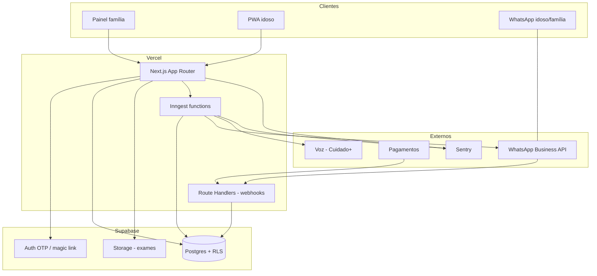
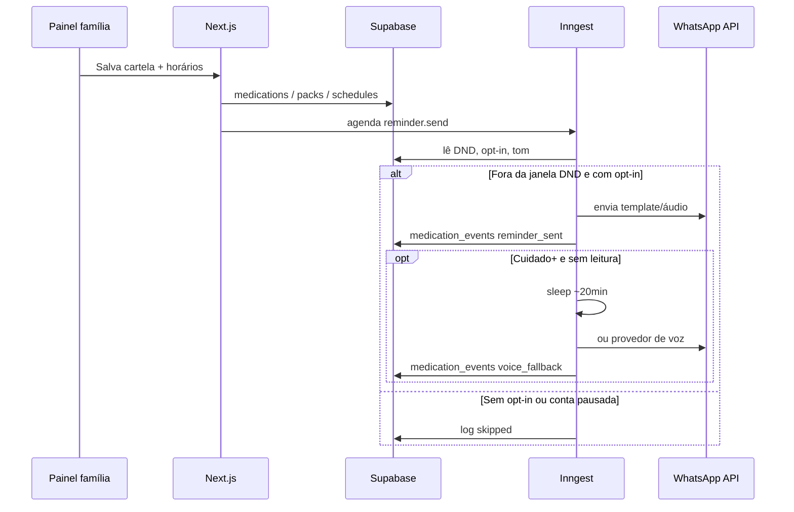

# Zelita — Arquitetura da solução

> Documento de arquitetura técnica do MVP.
> Status: decisão consolidada para início da implementação
> Data: 2026-08-12
> Relacionados: [PRD do MVP](./prd-mvp.md) · protótipo em `zelita-prototipo.html/`

---

## 1. Objetivo

Definir como a Zelita será construída e hospedada no MVP: superfícies, stack, filas, monitoramento e limites explícitos — para a fatia 1 (auth + idoso + cartela) começar sem retrabalho de infraestrutura.

**Princípio:** um app Next.js na Vercel + Supabase como backend de dados/auth/storage + jobs serverless para lembretes. Sem microserviços e sem worker BullMQ no MVP.

---

## 2. Decisões fechadas

| Tema | Decisão | Motivo |
| --- | --- | --- |
| Framework | **Next.js (App Router)** | Landing + painel + convites + webhooks no mesmo deploy |
| Hosting | **Vercel** | Deploy nativo Next, Cron, envs, edge/serverless |
| Backend de dados | **Supabase** (Postgres + Auth + Storage + RLS) | Multi-família, papéis, exames, auth OTP |
| Fila / jobs | **Inngest** (1ª opção) | Agenda, delay (ex.: voz em 20 min), retry — compatível com serverless |
| Monitoramento | **Sentry** (`@sentry/nextjs`) | Erros e traces desde a fatia 1 |
| Redis | **Não no MVP**; Upstash só se rate limit/cache doer | Evitar dependência cedo |
| BullMQ + worker | **Fora do MVP** | Exige processo 24/7 fora da Vercel |
| Canal idoso | WhatsApp Business API (provedor oficial) | Canal principal do PRD |
| Pagamentos | Provedor externo (a escolher); webhook no Next | Cartão nunca armazenado na Zelita |

### Alternativas consideradas

| Opção | Por que não agora |
| --- | --- |
| Vite + SPA | Landing, convites e webhooks ficam piores; PWA idoso pode ser Vite **depois**, se necessário |
| BullMQ + Redis clássico | Worker separado (Railway/Fly) aumenta ops sem ganho no volume do MVP |
| Só Supabase Cron + tabela de jobs | Viável como plano B; mais artesanal que Inngest |
| Upstash QStash | Plano B se Inngest não servir; mais “HTTP puro”, menos DX tipada |
| Backend Nest/separado | Duplica deploy sem necessidade com Supabase + Route Handlers |

---

## 3. Visão geral



---

## 4. Superfícies da aplicação

| Superfície | Tecnologia | Deploy | Responsabilidade |
| --- | --- | --- | --- |
| Landing | Next.js (SSR/SSG) | Vercel | Conversão, trial, SEO |
| Painel da família | Next.js (App Router) | Vercel | Gestão: remédios, SOS, geo, exames, pessoas, plano |
| Auth / onboarding | Next.js + Supabase Auth | Vercel | OTP e-mail, cadastro 8 passos |
| PWA do idoso | Next.js (rota dedicada) no MVP | Vercel | Início, horários, SOS, vínculo; sem login |
| WhatsApp / voz | Provedores externos | — | Lembretes e alertas; Zelita só orquestra |
| Jobs | Inngest (funções no repo Next) | Vercel + Inngest Cloud | Lembretes, retentativas, fallback de voz, avisos de cartela |

**Nota:** se o bundle do PWA idoso pesar demais depois do MVP, avaliar app Vite mínimo só para o idoso. Não é pré-requisito da fatia 1.

---

## 5. Stack por camada

| Camada | Escolha | Observação |
| --- | --- | --- |
| UI | React + Tailwind (+ shadcn/Radix quando entrar design system) | Seguir linguagem visual do protótipo |
| App | Next.js App Router | Server Components por padrão; Client só quando necessário |
| Auth | Supabase Auth (e-mail + OTP / magic link) | Sem senha no MVP |
| DB | Supabase Postgres | Schema conforme PRD §4 |
| Autorização | RLS por `account_id` / `care_recipient_id` / `role` | Matriz de papéis do PRD §6 |
| Arquivos | Supabase Storage + URLs assinadas | Exames PDF/imagem |
| Jobs | Inngest | Ver §7 |
| Mensageria | WhatsApp Business API | Templates + opt-in |
| Voz | Provedor a definir (Cuidado+) | Acionado por job com delay |
| Billing | Provedor a definir | Webhook → `subscriptions` |
| Observabilidade | Sentry | Erros app + funções Inngest quando aplicável |
| Analytics produto | Depois (ex.: Vercel Analytics / PostHog) | Fora do caminho crítico da fatia 1 |

---

## 6. Domínios e responsabilidades

| Domínio | Onde vive | Notas |
| --- | --- | --- |
| Conta, membros, convites | Postgres + RLS | Convite 7 dias |
| Pessoa cuidada | Postgres (**sem** `auth.users`) | Acesso via vínculo de device / PWA |
| Medicamentos e cartelas | Postgres + jobs Inngest | Cálculo de fim e avisos no app + jobs |
| Lembretes | Inngest → WhatsApp (+ voz) | Evento `reminder_sent` ≠ tomada confirmada |
| SOS | API/PWA → DB → notificação | Ignora DND do familiar; disclaimer SAMU/Bombeiros |
| Localização | Device → API → DB | Consentimento revogável; Cuidado+ |
| Exames | Storage + metadados | Sem OCR/IA no MVP |
| Billing / trial | Webhook + status da conta | Trial 30 dias; pausa sem cobrança automática |
| Auditoria | `audit_log` / `notification_log` | Acessos a dados de saúde |

---

## 7. Filas e jobs (Inngest)

### 7.1 Por que Inngest (e não BullMQ na Vercel)

- Functions da Vercel são **efêmeras**; BullMQ precisa de **worker Node sempre ligado**.
- Rodar BullMQ implica segundo serviço (Railway/Fly/Render) + Redis gerenciado.
- No volume esperado do MVP, Inngest cobre: agendar horário, retry, `sleep` de 20 min para voz, observabilidade de runs.

### 7.2 Catálogo inicial de funções

| Função | Trigger | Comportamento |
| --- | --- | --- |
| `med/reminder.schedule` | Cartela/horário criado ou alterado | Agenda ocorrências (ou reconcilia janela) |
| `med/reminder.send` | Horário devido | Respeita DND do idoso; envia WA; grava `reminder_sent` |
| `med/reminder.voice_fallback` | Após send, se plano Cuidado+ | `step.sleep(~20m)`; se sem leitura, dispara voz |
| `med/pack.refill_check` | Cron diário ou evento | Avisos “faltam N dias” / último dia |
| `sos/notify` | SOS confirmado | Notifica papéis corretos; canais WA/e-mail/painel |
| `billing/trial_ending` | Trial −5 dias | E-mail + painel ao admin |
| `billing/pause_if_unconfirmed` | Fim do trial | Pausa conta; **não** cobra sozinho |

### 7.3 Fluxo — lembrete de remédio



### 7.4 Plano B / evolução

1. **Upstash QStash** — se quiser fila só HTTP, sem Inngest.
2. **Supabase Cron + `scheduled_jobs`** — tudo no Postgres; mais manutenção própria.
3. **BullMQ + worker + Redis** — só com evidência de escala ou limites do Inngest; documentar custo ops antes.

**Redis (Upstash):** opcional mais tarde para rate limit de OTP/webhooks e cache pontual — **não** orquestra lembretes no MVP.

---

## 8. Autenticação, autorização e dados

### 8.1 Auth

- Familiar/cuidador: e-mail + código (10 min; reenvio invalida anterior).
- Pessoa cuidada: **sem** login; device vinculado (token/QR) abre PWA.
- Sessão: cookies/session Supabase no Next (padrão oficial `@supabase/ssr`).

### 8.2 RLS (resumo)

- Todo acesso a dados de cuidado filtrado por membership na conta.
- Papéis: `admin` · `caregiver` · `viewer` · `emergency_contact` (matriz no PRD).
- Service role apenas em Route Handlers / Inngest confiáveis (webhooks, jobs) — nunca no client.

### 8.3 Privacidade

- Opt-in WhatsApp antes de lembretes recorrentes.
- Consentimento de geo revogável.
- SOS e billing: idoso nunca vê cobrança.
- LGPD: exportar/excluir — fluxo no PRD (fatia 5 / P1).

---

## 9. Integrações externas

| Integração | Direção | Entrada na Zelita |
| --- | --- | --- |
| WhatsApp Business API | Bidirecional | Envio via job; status/webhooks em Route Handler |
| Voz | Saída (+ status) | Job de fallback |
| Pagamentos | Webhook | Atualiza plano/status; sem armazenar PAN |
| Sentry | Saída | SDK Next + contexto de usuário/conta (sem PHI desnecessário) |
| Inngest | Controle de jobs | Cloud Inngest ↔ functions no deploy Vercel |

Provedores concretos de WhatsApp, voz e pagamento permanecem nas **decisões em aberto** do PRD até escolha comercial.

---

## 10. Observabilidade

| Tipo | Ferramenta | Uso no MVP |
| --- | --- | --- |
| Erros / performance | Sentry | App Router, client, server; alertas em falha de envio crítico (SOS, lembrete) |
| Runs de job | Dashboard Inngest | Falhas, retries, latência de reminder/SOS |
| Logs | `notification_log` + logs Vercel | Auditoria de canal e status do provedor |
| Produto | Depois | Ativação cartela, D7/D30 — métricas do PRD §11 |

**Regra:** não logar corpo completo de dados de saúde em ferramentas externas; IDs + tipo de evento bastam na maior parte dos casos.

---

## 11. Ambientes e configuração

| Ambiente | Uso |
| --- | --- |
| `local` | Dev com Supabase local ou projeto de staging |
| `preview` | PRs na Vercel |
| `production` | Produção |

Secrets apenas em env da Vercel / Supabase (nunca commitados):

- `NEXT_PUBLIC_SUPABASE_URL` / `NEXT_PUBLIC_SUPABASE_ANON_KEY`
- `SUPABASE_SERVICE_ROLE_KEY` (só server)
- `INNGEST_EVENT_KEY` / `INNGEST_SIGNING_KEY`
- `SENTRY_DSN` / auth token de build
- credenciais WhatsApp, voz, pagamento

---

## 12. Estrutura de repositório sugerida (Next.js)

```text
apps/web ou raiz do Next
  app/
    (marketing)/          # landing
    (auth)/               # login / onboarding
    (family)/             # painel autenticado
    (elder)/              # PWA idoso
    api/
      webhooks/           # whatsapp, billing, inngest
  lib/
    supabase/             # client, server, middleware
    inngest/              # client + functions
    domain/               # meds, sos, billing (funções puras)
  components/
supabase/
  migrations/
  policies/
docs/
  prd-mvp.md
  arquitetura-solucao.md
```

Ajustar monorepo vs repo único na criação do projeto; o importante é **domain/** isolado de UI e **migrations** versionadas.

---

## 13. Ordem de implementação (alinhada ao PRD)

| Fase | Entrega | Infra necessária |
| --- | --- | --- |
| Fatia 1 | Auth + care recipient + cartela + reminder job + WA sandbox | Vercel, Supabase, Inngest, Sentry, WA teste |
| Fatia 2 | SOS + PWA vínculo | Mesma base |
| Fatia 3 | Convites, RLS completa, exames | Storage quotas por plano |
| Fatia 4 | Geo + billing real | Provedor pagamento; voz se Cuidado+ |
| Fatia 5 | LGPD, polimento, landing final | — |
| Pós-MVP | Avaliar Redis Upstash / BullMQ / PWA Vite separada | Só com gatilho de escala ou DX |

---

## 14. Não-objetivos de arquitetura (MVP)

- Cluster Kubernetes / ECS
- Microserviço por canal (WA, voz, billing)
- BullMQ + Redis como padrão
- Segundo backend Nest “por precaução”
- IA clínica, OCR de exames, prontuário
- App nativo (iOS/Android store)

---

## 15. Riscos e mitigações

| Risco | Mitigação |
| --- | --- |
| Limites/custo Inngest | Monitorar runs; plano B QStash / cron Supabase |
| WhatsApp templates / opt-in | Fluxo de autorização antes de recorrência |
| Service role vazando | Só server; revisão de Route Handlers |
| Falsa adesão a medicamento | Linguagem do PRD; eventos `reminder_sent` apenas |
| SOS ≠ emergência pública | Disclaimer fixo; copy “avisa a família” |
| Cold start / delay de job | Alertas Sentry + Inngest em falhas de `reminder`/`sos` |

---

## 16. Referências

- [PRD do MVP](./prd-mvp.md)
- Protótipo: `zelita-prototipo.html/zelita-prototipo.html`
- Vault Obsidian: `10 Dev/Pessoal/SaaS/zelita/` (`definicao-produto`, `prd-mvp`, `zelita`)

---

*Documento criado em 2026-08-12 a partir da discussão de stack (Next.js · Vercel · Supabase · Sentry · Inngest).*
